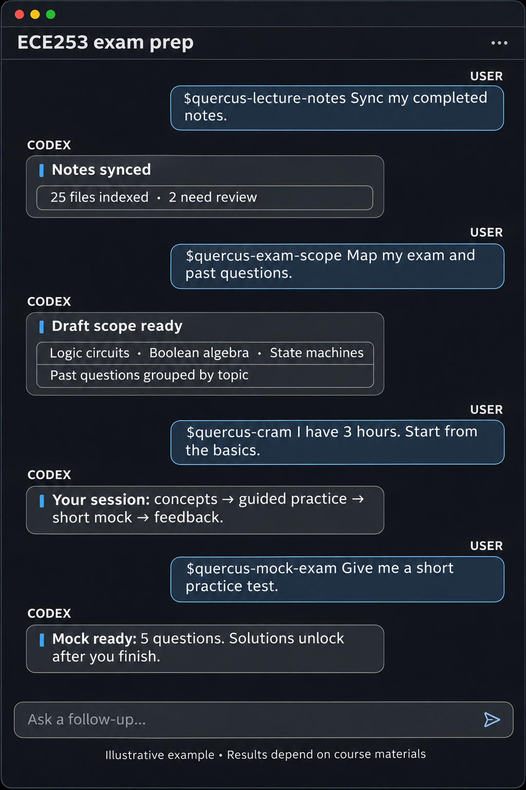

# Canvas study automation

A local Python tool and Codex skills for working with Canvas courses. Designed by a University of Toronto student, the project was originally built for Quercus, U of T’s Canvas installation. The tool lists courses, previews and downloads likely lecture notes, and retrieves assignment and syllabus information. The skills guide Codex through those tasks, course summaries, and exam preparation.

Note. I use codex here since I find ChatGPT does better at explaining than Claude.

## Example Codex conversation

This illustration shows how a student might call the exam-preparation skills and receive course-specific guidance. The outputs are examples and depend on the materials available in Canvas.



## Requirements

- Python 3.8 or later. The tool uses only the Python standard library.
- A Canvas account and a personal access token, if your institution enables token creation. Look under **Account → Settings → New Access Token** in your institution’s Canvas site.
- Codex with support for local skills, if you want to use the skills.

Treat your access token like a password. Do not commit it or paste it into a chat. The commands prompt for it without displaying what you type. For repeated commands, you may instead set `QUERCUS_TOKEN` in your terminal session; avoid putting it in shell history. You can also use the ignored local `.env` file as described below. Remove it with `unset QUERCUS_TOKEN` when finished.

## Set up your Canvas access token

1. Sign in to your institution’s Canvas site in your browser (for U of T, [Quercus](https://q.utoronto.ca/)). Open **Account → Settings** and look for **New Access Token**. If the option is not available, ask your institution about API access; do not try to bypass its controls.
2. Give the token a recognizable purpose and an expiration date if offered. Generate it and copy it into a password manager or another secure location. Canvas may show the token only once.
3. Run a command such as `python3 quercus.py courses` from the project directory. Paste the token at the hidden prompt and press Enter; nothing is shown while you type. Repeat for each command, or use the session option below.

Alternatively, save the token in the local `.env` file in the project folder. Create the file if it does not exist, then edit the line below and replace the placeholder with your token:

```text
QUERCUS_TOKEN=your-token-here
```

Save the file and run `python3 quercus.py courses`. Restrict access with `chmod 600 .env`. The file is ignored by Git, but it contains a credential in plain text: anyone who can read the file can use it. An existing `QUERCUS_TOKEN` environment variable takes precedence over the file. Do not share the file or commit it.

For a single terminal session, you can avoid repeated prompts without putting the token in your shell history:

```sh
read -rs 'QUERCUS_TOKEN?Quercus access token: '  # zsh
export QUERCUS_TOKEN
python3 quercus.py courses
unset QUERCUS_TOKEN
```

The `read` syntax above is for the default macOS zsh shell; enter the token only at the prompt, not on the command line. Other shells may use different syntax. An environment variable is inherited by processes launched from that terminal, so use it only in a trusted session. Keep tokens out of chat, Git and logs. If a token is exposed or no longer needed, revoke it in Canvas **Account → Settings** and create a replacement if needed. Token creation and expiration options depend on institutional settings.

## Canvas institution setup

The current implementation defaults to Quercus at `https://q.utoronto.ca` and has been developed against U of T courses. It does **not** yet have a command-line setting for the Canvas host. To try it with another institution, open `quercus.py` and change the `BASE` constant to your institution’s exact HTTPS Canvas origin, such as `https://canvas.example.edu` (with no path or trailing slash). Use a token issued by that same Canvas site. Verify the address with your institution before entering a token.

The Canvas API and permissions vary by institution; the workflows have not been validated on every Canvas installation. The CLI file, environment variable and skill names retain the `quercus` name for compatibility. They work against the configured `BASE`, not a separate institution selector.

## Installation

```sh
git clone https://github.com/huast07/canvas-automation.git
cd canvas-automation
python3 -m pip install -r requirements.txt
python3 quercus.py --help
```

Install the skill folders into your personal Codex skills directory:

```sh
mkdir -p ~/.codex/skills
cp -R skills/quercus-* ~/.codex/skills/
```

Review existing folders before copying if you already have skills with those names. Restart Codex or start a new chat if the new skills do not appear immediately. The skills expect this project as the working directory; open Codex in the cloned repository. Skills are instructions for Codex, not standalone executable programs.

## Set up and use each skill

### List courses: `quercus-courses`

Open the project in Codex and ask it to list your Canvas courses, or invoke `$quercus-courses`. The skill uses:

```sh
python3 quercus.py courses
```

Enter your token at the hidden prompt and note the course ID. If Codex cannot access a token configured in its environment, run the command yourself and share the course list, not the token.

### Download lecture notes: `quercus-lecture-notes`

Ask Codex to download lecture notes for a course, or invoke `$quercus-lecture-notes` with its course ID. The skill prefers completed notes over a matching blank or skeleton version when it can identify both. It reports uncertain matches and keeps empty notes when no completed version is found. The downloader also suppresses a blank or partially annotated version when it can identify a clearly matching completed file; for separate completed-notes indexes, it requires both lecture-number and topic evidence. Ambiguous variants remain visible for review; use `--include-id` to keep both. To run the underlying commands yourself:

```sh
python3 quercus.py download COURSE_ID --preview
python3 quercus.py download COURSE_ID
```

Preview first. The filter selects documents whose name or folder contains lecture, lec, notes, or slides, and excludes names or folders indicating assignments, exams, tutorials, solutions, or syllabi. This heuristic can miss notes or select unrelated files. The tool uses the course Files API, or accessible module file items and same-course file links on lecture-named module pages when the course-wide Files list is restricted; module and page inspection can omit files. It does not download external links. Files go into `downloads/` by course and folder; add `--output PATH` to change the destination. Existing files are skipped. Changed remote files can be downloaded as separate copies with `--download-updates`; previously downloaded files are not removed.

### Summarize a course: `quercus-summary`

Download the lecture notes first, then ask Codex to summarize a course or invoke `$quercus-summary` and identify its folder under `downloads/`. Codex reads available materials, summarizes topics and connections, cites the files, and identifies material it cannot read. You can also point it at another local folder of course materials. A summary only covers the files actually available and readable.

### Check assignments: `quercus-deadlines`

Ask Codex for the next assignment due in a course, or invoke `$quercus-deadlines` with the course ID. The skill uses:

```sh
python3 quercus.py due COURSE_ID
python3 quercus.py syllabus COURSE_ID
```

The first command displays future dated Canvas assignments in your computer's local timezone, with submission status when available. The second prints the syllabus body as HTML. Codex can compare the two and flag syllabus-only dates or discrepancies. A linked syllabus may need to be provided separately. This is an on-demand check; it does not schedule notifications. Request a separate scheduled reminder if you want one.

### Prepare for an exam: `quercus-exam-prep`

Place your past midterms or finals and the instructor's stated exam scope in a local folder, alongside or separate from your downloaded notes. Ask Codex to use `$quercus-exam-prep`, identify the files and exam, and describe any topics to exclude. The skill categorizes past questions by topic and source, then creates a progression from basic concepts and practice to exam-level problems, with hints and worked solutions. It will ask for missing exam papers or scope rather than assume lecture downloads contain them.

## Privacy and limitations

The tool only reads data from the configured Canvas site; it does not submit assignments or modify courses. Your token grants access to your account, so revoke it through your Canvas account if exposed. Downloaded materials remain on your computer and are ignored by Git by default. Some course content can be unavailable, locked, image-only, or hosted outside Canvas; the tool and summaries cannot guarantee complete coverage.

## Exam preparation workflows

The repository also includes skills for an end-to-end preparation session: `$quercus-prepare-exam`, `$quercus-document-import`, `$quercus-exam-scope`, `$quercus-study-planner`, `$quercus-cram`, and `$quercus-mock-exam`. Install or update them using the installation instructions above, then start a new Codex chat in this project. Ask Codex to use `$quercus-prepare-exam` to choose a course, sync lecture notes, map exam scope and choose a practice path. `$quercus-exam-prep` requires lecture sync and scope mapping first. Cram mode uses the same prerequisites and adapts the session to available time. These are Codex skills: the model performs the interpretation, tutoring and feedback; the Python CLI does not itself generate summaries or questions.

Preview reports file IDs and whether candidates are missing locally or changed remotely. Override the heuristic when necessary:

```sh
python3 quercus.py download COURSE_ID --preview --include-id FILE_ID --exclude-id OTHER_ID
python3 quercus.py download COURSE_ID --include-id FILE_ID --exclude-id OTHER_ID
```

For courses with different naming conventions, preview a course-specific case-insensitive regular expression before using it. For example, a course that labels slides with a chart symbol can use:

```sh
python3 quercus.py download COURSE_ID --preview --include-pattern '📈'
python3 quercus.py download COURSE_ID --include-pattern '📈'
```

Choose patterns based on that course's actual titles, not the example. Use repeatable `--exclude-pattern` or `--exclude-id` options to remove false positives; exclusions take precedence. Use `--only-pattern` when you want to restrict the selection to a particular module, page, or filename pattern instead of adding it to the defaults. Patterns match titles and folder or module names. Regular expressions can match more than intended, so always inspect the preview. Module previews may not have file timestamps; changed status is checked on download.

A sync records downloaded files in `study-data/COURSE_ID/sync.json`. It keeps existing files and reports remote changes. Add `--download-updates` to save changed versions as separate files without overwriting local copies. Metadata counts for modules, pages, discussions and assignments are informational; this version does not download their contents or reliably detect missing numbered lectures. A completed sync is not proof of complete lecture coverage.

Add a missing local document and inspect the course inventory:

```sh
python3 study.py import COURSE_ID lecture /path/to/notes.pdf
python3 study.py import COURSE_ID scope /path/to/exam-scope.pdf
python3 study.py import COURSE_ID past-exam /path/to/past-exam.pdf
python3 study.py inventory COURSE_ID
python3 study.py check-ready COURSE_ID
```

Imports are copied into `study-data/`, hashed for duplicate detection, and associated with the course. `study.py extract PATH` extracts text from UTF-8 text, DOCX and PPTX files, and from PDFs when the optional `pypdf` dependency is installed; image-only or corrupted pages can optionally be processed using local OCR. The exam-scope skill reviews source material and saves a scope JSON record using `study.py save-scope COURSE_ID PATH`; it requires `topics` and `problems` arrays; `templates/exam-scope.example.json` provides a starting structure. Missing citations are reported as warnings. `study.py record-attempt COURSE_ID PATH` appends a JSON attempt with a `topic` field only when requested by the student. Both downloads and study data are local and ignored by Git; to remove them, delete the relevant course folders yourself. Deleting the Git repository alone does not remove copies elsewhere.

Run the local tests with `python3 -m unittest discover -s tests -v`. The skill workflows depend on Codex and available document tools and have not been validated against every course or exam format. Read generated answers critically and verify exam dates and requirements with the instructor.

### macOS certificate verification error

If Python reports `CERTIFICATE_VERIFY_FAILED`, check its certificate setup. Python.org installations on macOS include an **Install Certificates.command** in `/Applications/Python 3.x/`. Alternatively, when the Python `certifi` package is already installed and Python has no configured default certificate store, this tool uses its CA bundle automatically. If you manage a custom trust store, set `SSL_CERT_FILE` to its CA bundle. Keep certificate verification enabled.

### PDF extraction and local study plans

For PDF text extraction install the optional dependency with `python3 -m pip install -r requirements.txt`. `python3 study.py extract PATH` labels PDF pages and reports empty or obviously corrupted text. To attempt local OCR on those pages, install `pdftoppm` (Poppler) and `tesseract`, then use `python3 study.py extract PATH --ocr` or `python3 study.py index COURSE_ID --ocr`. OCR runs locally and its output is marked for review; mathematical notation and handwriting can be inaccurate. DOCX and PPTX extraction may omit equations, diagrams and layout, so check the originals.

After syncing lecture notes and saving a reviewed scope, create an editable local plan or budget a cram session:

```sh
python3 study_plan.py create COURSE_ID --exam 2027-04-20T14:00-04:00 --start 2027-04-10 --days 6 --minutes 45
python3 study_plan.py cram COURSE_ID --exam 2027-04-20T14:00-04:00 --minutes 90
python3 study_plan.py review COURSE_ID
```

Use your own dates and timezone offset. `create` uses consecutive dates up to the exam, so edit `study-data/COURSE_ID/study-plan.json` to match your actual availability. It does not schedule notifications by itself. To move incomplete sessions, run `python3 study_plan.py reschedule COURSE_ID --start YYYY-MM-DD --days N`; completed sessions are preserved, and the command fails without changing the plan if there are too few days. Export a local calendar file with `python3 study_plan.py export-ics COURSE_ID /path/to/study.ics --time 18:00 --offset=-05:00`. Add `--reminder-minutes 15` if you want a 15-minute reminder included for each event. Importing the file into a calendar is a separate action, and reminder delivery depends on that calendar. The offset is fixed for all sessions, so check it for daylight-saving changes and existing calendar conflicts. Mark recorded attempts with `needs_review: true` to include them in the review queue; edit or delete local records to correct or remove them. Cram mode orders confirmed topics using only explicitly recorded weights and includes saved uncertainties; check the source and coverage before using the suggested order. These plans are suggestions, not predictions of performance.

### Course sources and scope

Capture the course syllabus and announcements for the relevant date range, then index locally downloaded and imported materials:

```sh
python3 quercus.py context COURSE_ID --start 2026-09-01 --end 2026-12-31
python3 study.py index COURSE_ID
```

Use your own course dates. Canvas defaults to a short announcement window, so the command requires an explicit range. Course context and extracted text are stored under the ignored `study-data/` directory. The source index reports when a course has no downloaded or imported documents, as well as missing files, extraction errors and pages requiring OCR; it does not automatically understand the documents. Ask `$quercus-exam-scope` to inspect the sources and produce a reviewed, cited scope and past-problem catalog. `$quercus-summary` uses the same index. Codex generates the interpretation and practice in conversation; source text may be transmitted to the model service used for that conversation, so share only materials you are permitted to use and are comfortable processing there.

### Past problems and review records

After importing past exams as `past-exam` and running `study.py index`, run `python3 catalog.py COURSE_ID` to create a draft `problem-candidates.json`. It finds some numbered questions, but boundaries, pages, diagrams and categories must be checked against the original. To suggest groups from your own topic terms, prepare rules using `templates/topic-rules.example.json` and run `python3 map_problems.py COURSE_ID --rules /path/to/rules.json` after saving a scope. It labels matches as needing review and leaves unmatched questions unclassified; it never claims keyword matches establish exam relevance. It may miss or split questions; the scope skill reviews the draft rather than treating it as an authoritative catalog.

To record a practice attempt, create a local JSON file containing, for example, `{"topic":"Forces","needs_review":true,"feedback":"Review sign conventions"}`, then run `python3 study.py record-attempt COURSE_ID /path/to/attempt.json`. It returns an ID and defaults the review time to the next day. `python3 study_plan.py review COURSE_ID` lists due attempts; add `--all` to see upcoming ones. After revisiting an item, use `python3 study.py review-attempt COURSE_ID ATTEMPT_ID --outcome correct` or `--outcome retry` to suggest another review. The 1/3/7-day intervals are editable heuristics, not an assessment of mastery. Use `python3 study.py update-attempt COURSE_ID ATTEMPT_ID corrections.json` to update fields or `python3 study.py remove-attempt COURSE_ID ATTEMPT_ID` to delete one. These records are local and should only be saved with the student's consent.

`python3 study.py export COURSE_ID /path/to/export.json` exports local record metadata, not the downloaded documents. To remove an imported copy, find its SHA-256 in `study-data/COURSE_ID/imports.json` and run `python3 study.py remove-import COURSE_ID FULL_SHA256`. Re-run indexing after removing a file. Extracted text and any previously made exports may remain; remove the course's `study-data/` and `downloads/` folders separately if you want to delete all local copies.

### Check basic arithmetic

`python3 check_math.py '2*(3+1)/4' '2'` compares arithmetic values exactly. It supports numbers, parentheses, `+`, `-`, `*`, `/`, and integer `**` powers. A match does not verify the formula, units, assumptions or a symbolic solution; unsupported expressions need another method.

### Persistent practice and mock sessions

After lecture sync and exam scope mapping, create a reviewed question bank from `templates/question-bank.example.json`. Set `exam_id` to the exact saved scope ID, include source references, hints and checked solutions, and set `reviewed` to `true` once reviewed. Codex can help write the bank, but the program does not generate questions or evaluate open-ended answers. Import a bank and start a session:

```sh
python3 practice.py import-bank COURSE_ID /path/to/question-bank.json
python3 practice.py start COURSE_ID --mode guided --minutes 30 --count 3
python3 practice.py show COURSE_ID SESSION_ID
python3 practice.py hint COURSE_ID SESSION_ID QUESTION_ID
python3 practice.py answer COURSE_ID SESSION_ID QUESTION_ID /path/to/answer.txt
python3 practice.py solution COURSE_ID SESSION_ID QUESTION_ID
```

Use `--mode mock` to keep hints and solutions hidden until `python3 practice.py finish COURSE_ID SESSION_ID`; then use `practice.py solutions COURSE_ID SESSION_ID`. The mock reports elapsed time and stops accepting answers after the deadline; it does not automatically grade them. After reviewing an answer, `python3 practice.py assess COURSE_ID SESSION_ID QUESTION_ID --result retry --confidence 2` records the student-reviewed result and suggests a next-day review. Results can be `correct`, `partial`, `retry`, or `unknown`; confidence is optional, from 0 to 5. Mock answers can be assessed after finishing. Question banks, solutions and submitted answers are stored in `study-data/` and excluded from Git. Import does not overwrite an existing bank.

### Concepts page before practice

The exam-prep and cram skills build a local HTML lesson before tutoring. It contains a categorized visual mind map of concepts, methods, variants and relationships; explanatory graphics; concepts required for each problem type; and lecture-by-lecture explanations. Each lecture can cover several concepts, and map nodes link to individual concept pages with first principles, assumptions, reasoning, examples and citations when supported by the materials. Missing explanations are identified explicitly. A source-coverage checklist records which lectures were mapped, partially inspected, unavailable or outside the exam; these statuses are supplied by the lesson author and do not independently prove completeness. Open the illustrative [example concepts page](examples/concepts-demo.html) from a local clone; its course and source labels are fictional.

Codex prepares the content from your reviewed scope and course materials using `templates/concept-lesson.example.json`. The renderer checks the course prerequisites, exam ID and required sections, then saves a new main page and linked subpages in `study-data/COURSE_ID/lessons/`. Codex can open a temporary local lesson server and wait for you to select **I understand**:

```sh
python3 concept_page.py COURSE_ID /path/to/lesson.json
python3 lesson_ready.py /path/to/generated-lesson.html --open
```

The button signals the waiting Codex session that you are ready; return to the chat to begin progressive tutoring. For each sourced problem type, Codex starts with individual concepts and builds toward combined, midterm-level problems. Selecting the button does not establish mastery. If the local server cannot run or times out, open the saved HTML directly and tell Codex in chat when you are ready. The local URL is temporary and stops working when the listener ends.

The HTML is self-contained and renders input as text; it does not automatically verify the lesson’s claims, sources or mathematical reasoning. Review them against the original course materials. Write LaTeX equations in lesson text between `\(` and `\)` for inline math or `\[` and `\]` for displayed equations. The renderer converts these locally to browser-native MathML; no network connection or external scripts are needed. Existing plain-text equations remain plain text until the lesson is regenerated with LaTeX markup. Diagram labels remain plain text. If opening the browser fails, open the printed file path manually.
