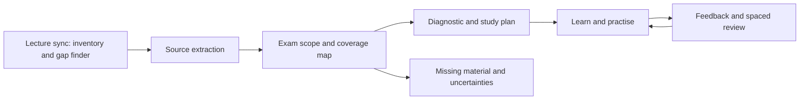

# Quercus midterm preparation: proposed plan

## Goal

Help a student who misses lectures catch up on the material actually available, identify what is assessed, and practise from fundamentals through exam-level problems. Start with one course and one exam; local-first, student-controlled, read-only Quercus access. A summary is an orientation tool, not the endpoint. The system must surface missing lecture context and never imply that downloaded slides substitute for everything said in class.

**Decision for review:** Build a local CLI + Codex skills MVP on the existing Python script, then add scheduling and a UI only after one real-course trial. The schedule below is a suggested design, not a claim that a particular algorithm is scientifically optimal.

## Evidence-informed learning design

| Evidence | Product choice | Qualification |
|---|---|---|
| [Dunlosky et al. (2013)](https://pubmed.ncbi.nlm.nih.gov/26173288/) review learning techniques, including practice testing and distributed practice. | Put retrieval practice and spaced review at the center; summaries orient the student. | Techniques vary by subject, learner, and assessment. No single review schedule is guaranteed optimal. |
| [Roediger & Karpicke (2006)](https://pubmed.ncbi.nlm.nih.gov/16507066/) found recall practice improved delayed retention of prose relative to repeated study in their experiments. | Ask the learner to retrieve or solve before showing answers; allow hints and corrective feedback. | A prose-memory result alone does not establish effectiveness for every quantitative course or AI-generated question. |
| [Firth, Rivers & Boyle (2021)](https://doi.org/10.1002/rev3.3266) review interleaving for concept learning and transfer. | Mix related question types after learners have acquired the basics, especially when selecting the right method is part of the exam. | Benefits depend on material and timing; do not replace initial instruction with random hard questions. |
| [Donoghue & Hattie (2021)](https://www.frontiersin.org/journals/education/articles/10.3389/feduc.2021.581216/full) synthesize evidence across ten study techniques. | Favor repeated practice over treating a generated summary as proof of mastery. | The review covers heterogeneous studies; effects should not be read as a guaranteed individual outcome. |

## Student journey

1. **Connect and choose:** Enter a personal token locally, list courses, pick a course and exam date. No token pasted into chat. Confirm the timezone and hours available; ask for accommodations, course format, and academic integrity rules only as relevant.
2. **Gather and audit:** Lecture sync inventories modules, pages, announcements, syllabus, recordings/transcripts where accessible, past exams and user-supplied material. It compares available lecture candidates against downloaded files by course, previews gaps, and downloads approved missing notes. Mark each item accessible, absent, unreadable or not synced. A missed lecture may contain context unavailable in uploaded slides: identify gaps and suggest office hours, official recordings, or classmates' permitted notes.
3. **Define scope:** Compare explicit instructor exam guidance, syllabus, announcements, and student-provided scope. Separate confirmed, inferred and unknown topics. Ask the student to resolve conflicts; do not infer the exam syllabus from old exams alone.
4. **Orient and diagnose:** Build a sourced topic map and concise prerequisite summaries. Calibrate the diagnostic to problem types found in course documents, labeling inferred exam relevance and gaps. Offer “I don't know” and record uncertainty, not a definitive mastery score.
5. **Practise progressively:** Run only after lecture notes have been synced for the course and the exam scope mapper has run. Use its key problem categories to explain basic concepts and solution approaches before giving problems. Adapt the format to the exam problem types found in course documents, from simple practice through scaffolded multi-step and original exam-level questions. Reveal hints and solutions on request, diagnose misconceptions in the student’s attempts, and guide them progressively toward a solution with corrective feedback and a worked solution. Mix topics after foundations. Show sources and assumptions; flag uncertain answer keys.
6. **Review and simulate:** Create short, revisable sessions leading to the exam. Revisit errors across days, mix question types, and offer a timed mock aligned to confirmed exam constraints. Report coverage and unresolved gaps, not predicted grades.
7. **Deadlines:** Compare assignment API records with syllabus and announcements; show timestamps, timezone, status and source. Schedule notifications only when the student explicitly asks and a scheduling integration is available.

## Skills and tools

| Skill / component | MVP responsibility and concrete output | Dependencies / boundaries |
|---|---|---|
| **Course discovery** (existing `quercus-courses`) | List course names, IDs and accessible enrollment. | Canvas courses API; read-only. |
| **Lecture sync** (extend `quercus-lecture-notes`) | Inventory each course, compare available lecture candidates with the local downloads and manifest, preview missing lectures, and download selected gaps. Its inventory and gap finder subtool reports available, downloaded, missing, inaccessible and unreadable items. | List modules, pages, syllabus, announcements and file metadata without downloading everything. Match by stable Canvas ID and version where possible; flag ambiguous matches and gaps inferred only from numbering. The filename filter is lossy; add include/exclude overrides. Links, recordings, unpublished and locked content may be inaccessible. |
| **Document import** (new) | Let students upload or select local missing lecture notes, exam scope documents and past exams; preview and assign each to a course and document type, then include it in the inventory and relevant workflows. | Preserve the original separately with user-provided provenance, avoid overwriting existing files, detect duplicates, report unreadable files, and allow removal. A CLI can select local paths; a future UI can offer an upload control. |
| **Document extraction** (tool) | Extract text and page/slide references from PDF, PPTX, DOCX and text; record extraction failures and OCR needs. | Use PDF/document tooling; OCR only where available. Preserve equations, diagrams and tables as unresolved when extraction loses meaning. |
| **Course summarizer** (existing `quercus-summary`) | Source-linked topic map, prerequisites, key definitions, examples, and coverage gaps. | Cite file + page/slide; distinguish source text from interpretation. |
| **Exam scope mapper** (new, includes past problem cataloguing) | One invocation maps the exam date, constraints, topic statuses and evidence, and catalogs past problems by question/subquestion with source, page, tags, prerequisites, difficulty, confidence and solution availability. Report conflicts for student confirmation. | Use syllabus, announcements, exam instructions and separately supplied past exams. Do not equate historical exam frequency with confirmed scope; flag OCR/diagram errors and respect instructor rules. |
| **Progressive practice tutor** (extend `quercus-exam-prep`) | Explain basic concepts first, then progressively teach solution methods for key exam problem categories. Calibrate original practice to problem types found in course documents; reveal hints and solutions, identify misconceptions, give corrective feedback, and guide students step by step toward a worked solution. Cite sources and flag uncertainty. | Requires a completed lecture sync and exam scope mapper run for the selected course and exam; if either is missing, guide the student through it first. Surface incomplete notes or scope rather than treating a completed run as complete coverage. Verify quantitative answers independently when feasible; no guarantee generated answers are correct. |
| **Diagnostic & error log** (new) | Record attempts, errors, confidence and feedback by topic; recommend next practice. | Student can correct records, reset or delete them; diagnostic is not a grade prediction. |
| **Study planner & review queue** (new) | Editable calendar of study blocks and spaced revisit prompts; adapt to time and exam date. | Scheduling defaults are heuristics; use active retrieval, do not promise a magic interval. No automatic external actions. |
| **Assignment deadlines** (existing `quercus-deadlines`) | Next dated assignments with timezone, status, links and syllabus discrepancies. | Due dates are not the same as exam scope. Confirm effective dates and syllabus-only items; no notification until separately requested. |
| **Cram mode** (new) | Given the exam time and available minutes, build a triaged, editable catch-up session: verified high-priority scope and prerequisites, brief concept refreshers, representative retrieval and problem attempts, corrective feedback, then a compact error review. Show omitted topics and source gaps. | Reuse lecture sync and exam scope mapping before generating topic-specific practice; if time or materials are missing, ask for them and show a transparent fallback. Past-paper frequency is only a tentative signal, not proof of exam weighting. Do not promise coverage or a grade. |
| **Mock exam & feedback** (later) | Timed, mixed problem set and rubric with review of mistakes. | Only after scope and answer verification; label original vs historical questions. |

## Architecture and source boundaries

- **Quercus adapter:** Canvas API with bearer token, paginated endpoints, limits and clear 401/403 handling. Query courses, course files/folders, modules/items, pages, assignments, announcements and syllabus where permitted. [Canvas API documentation](https://developerdocs.instructure.com/services/canvas/) and [pagination guidance](https://developerdocs.instructure.com/services/canvas/basics/file.pagination). A token only grants the account's existing permissions; availability depends on course settings. Avoid scraping login pages or bypassing access restrictions.
- **Credentials:** Prompt locally or use an OS credential store; token is never in Git, logs, output, or a model prompt. Never forward bearer credentials to an unrelated host on redirects. Permit revocation and deletion. The [Canvas OAuth guidance](https://developerdocs.instructure.com/services/canvas/oauth2/file.oauth) treats tokens as sensitive credentials.
- **Local store:** files in a course-specific folder plus SQLite or JSON records for source metadata, stable IDs, hash/version, extraction status, citations, exam scope, attempts and schedule. Make paths configurable. Default to local-only; disclose and obtain consent before transmitting course content to any external model provider. Respect course material and sharing rules.
- **Incremental sync:** list/preview first, fetch only approved categories; compare remote lecture candidates with downloaded files by course, identify missing and changed items, and offer a download or update without overwriting student edits. A numbering gap alone is only a possible missing lecture, not proof that a file exists. Record inaccessible files and partial failures. The current script skips existing files, so it needs explicit change detection before it can be called a sync.
- **Evidence chain:** every summary claim, scope item and historical problem points back to a source and page/slide; label inferred content and mark missing evidence. User-uploaded past exams are distinct from the lecture-note downloader.
- **Existing limitations:** current downloader uses a filename heuristic, can miss slides, and cannot detect updates. Current deadline command is on-demand and does not fully interpret syllabus attachments. Existing skills are instructions, not a complete automated tutor.

## Delivery sequence

### Phase 1 — Reliable course intake and deadlines

Harden course selection and lecture preview; add an inventory and gap-finder subtool, local-versus-remote comparison, explicit selection, local document import, sync manifest and missing-content report; extract syllabus and dated assignments with source and timezone. **Done when:** a test course with multiple pages, ambiguous filenames, a locked file and a changed file produces correct inventory, selection, and clear partial-failure reporting without leaking the token.

### Phase 2 — Course understanding and exam scope

Extract supported documents with page references; produce coverage map and source-linked summary. Add exam-scope entry with explicit confirmed/inferred/unknown categories and a catalog of supplied past problems; initial cataloguing may flag questions requiring manual review. **Done when:** sampled claims trace to readable source pages and missing/failed content is visible; the student can correct the scope.

### Phase 3 — Problem catalog and progressive tutor

Improve past-exam segmentation and tagging; add diagnostic, hints, original exercises, solutions and attempt history. **Done when:** a representative set of past questions is accurately mapped, practice progresses through difficulty, the tutor blocks until lecture sync and exam scope mapping have run, and mathematical answer checks catch seeded mistakes. Flag uncertain OCR and unsolved questions.

### Phase 4 — Study scheduling, cram mode and evaluation

Add editable sessions, spaced retrieval, mixed practice and a time-budgeted cram mode that prioritizes sourced exam scope and reports omissions; optionally integrate notifications with explicit setup. Pilot with a student in a real course. **Done when:** sessions fit the student's available time; missed sessions can be replanned; the student can export/delete data and see all source gaps.

## Evaluation and tests

- Mock Canvas API tests for pagination, expired tokens, redirects, course permissions, changed files and partial failures; verify no token or sensitive URL appears in logs.
- Document fixtures with scanned pages, equations, diagrams and corrupt files; check accurate citations and honest unreadable status. Human review a sample of question extraction, tags, solutions and scope claims.
- With consent, compare a baseline diagnostic to later parallel questions, while tracking completion, delayed retrieval, time spent, student corrections and unsupported answer rate. This is a usability/learning signal, not causal proof; small pilot and self-selection limit conclusions.
- For cram mode, test short and longer time budgets, a past or unknown exam date, absent materials, and that the selected tasks fit the stated time without claiming complete coverage.
- Test behavior for no past exams, no syllabus, missed sessions, accommodations, very short lead time, and a course dominated by proofs or essays. Respect accessibility and allow the student to change or decline the proposed schedule.

## Decisions to make together

1. Which course, exam date, and material formats should the first real-world trial target?
2. Should AI processing remain local, or may selected materials be sent to a specified provider with consent?
3. Is a terminal + Codex workflow sufficient initially, or is a graphical study interface necessary?
4. Which notification destination, if any, should be supported after the on-demand workflow works?

## Scenario walkthroughs and UX refinements

### Crammer: exam is imminent

The envisioned path is sound: select the course → lecture sync → exam scope mapper → cram mode, which draws on the progressive tutor and ends with a mock and feedback when time permits. Make this a single **Prepare for my exam** entry point that orchestrates the steps and shows progress, instead of requiring the student to remember five commands. Ask for actual time remaining and immediately estimate intake time; let the student select only relevant lecture candidates and surface the gaps. Start with a compact concept explanation and representative problem, guide the attempt with hints, then review recurring mistakes. Budget a short mixed mock and feedback when practical; for a very short session, use one or two representative questions with feedback rather than consuming the entire session on a full mock. Show omitted scope, uncertainty and time remaining, and let the student adjust priorities. Do not allow cram mode to bypass sync and scope mapping without a separate design decision.

### Regular attendee: preparing over several weeks

The student can select a course, use exam scope mapping to identify documented scope and past problem types, and return to the tutor and mock separately over time. The tutor still requires a prior lecture sync and scope-mapper run: if missing, offer a brief guided sync rather than a dead-end error. Recognize an already completed, current sync and avoid repeating downloads. Schedule optional retrieval and review sessions on separate days, interleave established problem types, and place a full mock close enough to the exam to be useful while leaving time for feedback and targeted practice. Allow the student to change the schedule and progress without assuming attendance implies mastery.

### Additional refinements for both

- Display source freshness and let the student rerun scope mapping after an instructor update; warn if a prior scope or sync is stale, without claiming it is automatically wrong.
- Support a fast diagnostic skip and self-selected priorities, but distinguish self-confidence from demonstrated performance. Record attempts only with student control and allow deletion.
- If course materials or past exams are missing, identify the gaps, offer a clear upload or local-file selection action for missing notes, scope documents and past exams, assign them to the course with provenance, and offer a useful partial workflow with clear limitations; never manufacture exam scope or solutions.
- Test these two journeys with real students and realistic time budgets before adding a complex dashboard. Measure time to first useful practice, actual completion, source coverage and student corrections rather than just the number of generated questions.
